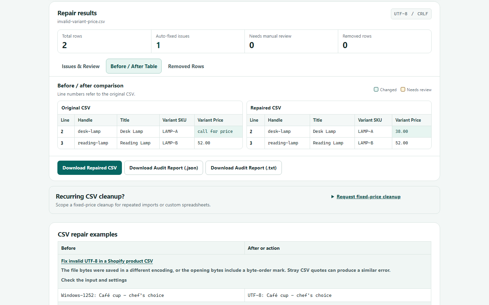
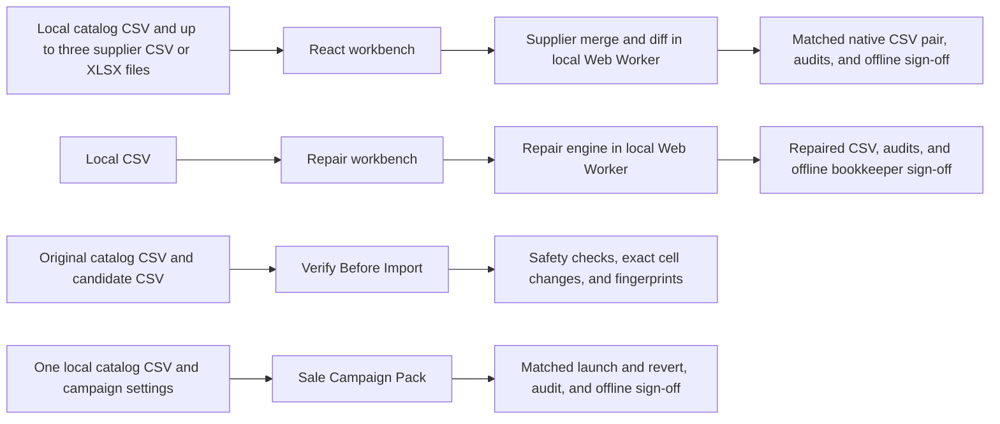

# ImportMedic

ImportMedic compares a Shopify, WooCommerce, or legacy BigCommerce product export with one to three supplier CSV or XLSX files in your browser. Use supplier prices directly or calculate retail prices from wholesale costs, with optional manual currency conversion, cost brackets, and stock updates where supported. Review proposed changes and competing offers before downloading matched update and rollback CSVs, audits, or a standalone Client Sign-Off HTML report. Save supplier mappings and store defaults as separate JSON files. A separate workbench repairs Shopify Products, QuickBooks Online Bank, and Stripe or PayPal CSVs and offers a printable Bookkeeper Sign-Off HTML report.

**Verify Before Import** inspects an existing update or rollback CSV against the original Shopify, WooCommerce, or legacy BigCommerce export. It checks product identity and grouping, shows exact changes in the allowed price or stock cells, and fingerprints both files in the browser. Store checks and imports take place in the store's admin.

**Sale Campaign Pack** prepares a discount and its matched revert from one product export. It previews the final sale prices against a required minimum retail floor and packages the pair with a JSON audit and offline Campaign Sign-Off report.

**Supplier Delta** compares a previous supplier pricebook with a new one. Review cost hikes, drops, added and removed SKUs before preparing a store update. Its CSV and offline sign-off are review reports for the two supplier files.

## Run locally

Use Node.js 24 and its bundled npm.

```sh
npm ci --ignore-scripts --cache .vite/npm-cache
npm run build
npm run preview -- --port 4173 --strictPort
```

Open the price update workbench and choose **Load Synthetic Agency Demo** for a Shopify direct-price example. To compare your own files, choose the platform and select a fresh product export and a supplier CSV or XLSX. Use **+ Add another supplier sheet** for a second or third file. **Build Update** and single-file repair run in local Web Workers with progress and **Cancel**. [Local price update workbench](http://127.0.0.1:4173/shopify-price-update-diff)

### Verify an update or rollback before import

1. Open **Verify Update / Rollback CSV** in the price workbench, choose the matching catalog platform, then add the original export and the candidate CSV. You can inspect files someone else prepared without rebuilding the batch.
2. Read **PASS** or **FAIL_UNSAFE**, compare both SHA-256 fingerprints with the files you received, and review each changed SKU and its exact before-and-after values. Check the allowed native columns, product or variation identities, and group rules. A change from `20.00` to `20.000` still changes the cell text.
3. If you generated the pair in the current workbench batch, choose **Load last generated pair** and verify the update and rollback in their respective tabs. For a saved pair, choose the rollback as the candidate and add the update under **Check a rollback with its matching update**. ImportMedic applies the actual update, applies the rollback, and compares the full result with the original catalog data.

With a baseline and candidate alone, zero residual differences means the supplied scoped cells agree with the original values. To verify that a rollback covers and reverses a particular update, use the actual matched update. Check the intended values and the current catalog before importing either file. Store login and live changes happen in the store's admin.

Open **Shortcuts (?)** or press `?` outside text entry. Press `/` to focus workbench search when available. Use `Escape` to close the dialog or cancel an active edit and return to its trigger. The dialog has a switch to turn off single-character shortcuts.

### Prepare a sale and its revert

1. Open **Sale Campaign Pack**, choose the catalog platform, and select a fresh product CSV or **Load Synthetic Promo Demo**. Use all priced rows or scope the campaign by SKU prefix or exact SKU list. Shopify also supports product handle and tag filters.
2. Set a **Percent off** from `1` to `90` or a **Fixed amount off** in store currency, then select rounding and enter a positive **Minimum retail floor**. Shopify starts with the current variant price. WooCommerce and BigCommerce start with a lower existing sale price when present, or the regular price otherwise. ImportMedic applies the discount and rounds before checking the floor. A result below the floor, at or under zero, or at or above the starting price holds the pair. Change the settings or skip the affected row. The optional cost check flags a promo price below recorded cost for review.
3. Review the before, promo, and revert cells. Shopify updates base variant price and compare-at price while preserving original titles, handles, options, SKUs, and sibling rows. WooCommerce updates `Sale price` while leaving `Regular price` in place. Legacy BigCommerce updates `Sale Price` on standalone `Product` rows with an original numeric sale price. The legacy **Ignore blank values during import** setting prevents an empty sale cell from clearing a price during revert, so a row with a blank original sale is held. [Native fields and exact clear behavior](docs/subsystems/promo-campaign.md#native-csv-scope)
4. Keep the Promo Launch and Promo End Revert downloads with the original CSV, JSON audit, and Campaign Sign-Off HTML. Compare SHA-256 values against the actual downloaded files. In **Verify Update / Rollback CSV**, replay the actual launch followed by its matched revert to check that every original catalog cell is recovered locally.

Schedule and import the files manually in the store's admin. Confirm the current prices and identities against the baseline before launch and against the matched launch before reverting. [Sale Campaign Pack contract](docs/subsystems/promo-campaign.md)

### Review Shopify prices and download the matched files

1. Check the join key and price mapping. For wholesale input, open **Pricing formula & rounding** and choose a multiplier, percentage markup, or target gross margin. You can add a minimum retail price. For a cross-currency batch, enable **Convert supplier currency (manual rate)** and enter the source code, store code, and exact positive decimal rate as store currency per unit of source currency. ImportMedic applies that rate before the retail formula and rounding, entirely in the browser. Conflicting currency evidence prevents export until resolved.
2. To update compare-at prices, map a supplier compare-at column or leave it unmapped and choose **Calculate compare-at price automatically**. Mapped amounts use the manual rate and round half up to cents when currency conversion is on. The automatic rule multiplies the final retail price and uses the same rounding setting. In a synthetic example, `10.00 EUR` at `1.0850` USD per EUR with a `2.2` retail multiplier and `.99` rounding yields `23.99 USD`. A `1.25` compare-at multiplier yields `29.99 USD`.
3. Confirm the columns and pricing settings, including the rate or store currency when prompted. Search by SKU or handle and review the supplier amount, computed retail price, and flagged rows. Enter manual overrides as final store-currency amounts. An opted-in compare-at amount must be strictly higher than the final retail price after rounding. Resolve the row or skip it before downloading. Shopify specifies a higher compare-at price for displaying a sale. [Shopify sale pricing](https://help.shopify.com/en/manual/products/details/product-pricing/sale-pricing)
4. Select **Download Safe Shopify Update CSV** and **Download Shopify Rollback CSV**, then download the CSV or JSON audit and the offline **Download Client Sign-Off (.html)** report as needed. The audit records any applied currency pair and exact rate. Keep the matched files with the source export. Both carry the original title, handle, options, and SKUs for complete affected product groups. The rollback preserves original price text and any included compare-at and inventory cells, including explicit blanks. To update compare-at, use a baseline with that column. Unrelated columns such as description, tags, and images are omitted. [Shopify product CSV requirements and overwrite rules](https://help.shopify.com/en/manual/products/import-export/using-csv#overwriting-product-details-using-an-import-csv-file)

ImportMedic re-parses both downloads and replays the update followed by its matched rollback against the uploaded snapshot in the browser. For a Shopify admin import, check the destination store, current titles, handles, option names and values, prices, and any included quantities against the relevant snapshot. Pause if anything has changed. Use the rollback only for its matched update after checking for later catalog edits and stock movement. The Shopify import and overwrite confirmation are manual steps.

Each XLSX supplier slot starts with the workbook's first visible worksheet. If there are multiple visible tabs, open **Supplier worksheet** beside that supplier's filename and select the intended tab. Check the new headers and suggested mapping before confirming. An explicit selection binds that slot to the exact worksheet name independently of the other slots. Store XLSX SKUs as text to preserve leading zeros. Numeric and scientific-notation SKU cells, formulas in mapped key, price or quantity cells, and duplicate keys within a sheet require review. ImportMedic warns about formulas with missing cached values and never evaluates workbook formulas.

### Compare two supplier pricebooks

1. Open **Supplier Delta** in the price workbench. Add the previous and new CSV or XLSX pricebooks, or choose **Load Synthetic Supplier Delta Demo**. For multi-tab Excel files, set **Previous worksheet** and **New worksheet** as needed.
2. Check each SKU and cost or price mapping. Map inventory on either side if needed. Compare amounts in the same currency. Review the signed changes and use **Cost Hikes**, **Cost Drops**, **Added**, **Removed**, and **Blocked** to inspect matching rows and source lines.
3. If duplicate SKUs or invalid mapped cells hold the CSV and sign-off, inspect the issue rows and download the JSON audit for review. Correct the files or mapping and compare again.
4. Keep **Supplier Delta CSV**, **JSON Audit**, and **Delta Sign-Off (.html)** with the original pricebooks. The HTML shows the top hikes and includes filters that work offline. Its footer records the source and CSV SHA-256 digests. The JSON audit records those digests and the SHA-256 of the actual downloaded HTML bytes. An XLSX input digest covers the whole original workbook. [Supplier Delta contract](docs/subsystems/supplier-delta.md)

### Update prices for one Shopify market

Use a Shopify product export containing `Price / <Market>`. In **Target price list**, choose that exact market. Enter final prices in the market's currency. If converting supplier currency, enter and confirm your own rate in market-currency units per one supplier-currency unit. The browser applies it before formulas, cost brackets, and rounding. Check the selected scope and applied rate in the review and audit. [Shopify international CSV columns](https://help.shopify.com/en/manual/products/import-export/using-csv#international-csv-columns)

The matched files carry the selected `Price / <Market>`, the same market's `Compare At Price / <Market>` if enabled, and the original identity fields and variant siblings for affected products. The base price, other markets, market inclusion, stock, and product content are omitted. Any retained or proposed fixed compare-at price must be above the final market price. Rows that need to turn a blank market value into a fixed amount require review. The rollback carries the exact original cell text. The paired replay checks the uploaded snapshot. Before either manual import, verify the exact market, currency, and affected groups in Shopify. Check current values against the matched update before applying its rollback. [Shopify overwrite rules](https://help.shopify.com/en/manual/products/import-export/using-csv#overwriting-product-details-using-an-import-csv-file)

### Price by cost bracket

Select **Tiered cost brackets** in **Pricing formula & rounding**. Add two to six tiers with strictly increasing positive upper limits and a final open-ended tier. Each tier uses a multiplier or percentage markup and can add a fixed fee in store currency. The rule matches on the exact cost after manual FX, before markup, floor, or rounding. A cost of `20.00` matches an upper limit of `20.00`, while `20.01` uses the next tier. With `2.5×` and `2.0×` in those tiers, **End in .99** gives `50.99` and `40.99` respectively. Check the matched tier in the diff, CSV and JSON audits, and Client Sign-Off HTML.

### Update existing WooCommerce products

Choose **WooCommerce** and try **Load Synthetic WooCommerce Demo**, or use a fresh export from the destination store. Match by exact SKU text. The native files carry changed simple products and variations with their original `ID`, `Type`, `SKU`, and `Parent`, plus `Regular price` and any enabled `Sale price` or `Stock` fields. The baseline needs a `Sale price` column when lowering regular prices and numeric tracked stock for rows included in a stock update. Attributes, descriptions, categories, tags, images, and metadata are omitted. Download both files together and inspect the variation IDs and parent references, prices, and included stock. [WooCommerce product CSV schema](https://woocommerce.com/document/product-csv-importer-exporter/#product-csv-import-schema)

The browser verifies both files against the uploaded snapshot. Use the pair with WooCommerce's built-in **Update existing products** importer in the same store after checking the current product identities and affected values. For rollback, compare the current values with the matched update and check for later price edits or stock movements first. [WooCommerce update instructions](https://woocommerce.com/document/product-csv-importer-exporter/#update-existing-products)

### Update existing BigCommerce products

Choose **BigCommerce** and **Load Synthetic BigCommerce Demo**, or use a fresh legacy Bulk Edit product export. Match by exact SKU text. The native files preserve `Item Type`, `Product ID`, `Product Name`, and the original `Product Code/SKU` or `Product SKU` heading. Standalone `Product` rows can carry `Price` and optional `Sale Price`. Eligible `Product` or `SKU` rows can carry mapped stock when the export confirms the corresponding tracking mode. The workbench holds grouped parent pricing because a change could flow through to variants. The legacy import treats SKU-row `Price` as read-only. [BigCommerce legacy product updates](https://support.bigcommerce.com/s/article/Updating-via-Import?language=en_US) · [Legacy export field names](https://support.bigcommerce.com/s/article/Legacy-to-Modern-Product-Transfer?language=en_US)

Download the matched files and inspect both in **Verify Update / Rollback CSV**. Read the original IDs and relationships with the proposed price and stock values. The files omit product descriptions, categories, images, and metadata. Review the current catalog values and the legacy importer mapping in your store before each manual import. Compare the current catalog with the matched update and check for later price edits or stock movement before rollback. [BigCommerce native CSV scope](docs/subsystems/bigcommerce-price-diff.md)

### Review batch impact and margins

After a catalog comparison, check **Batch Impact & Margin Summary** for price moves, average and range of gross margins, and the change in comparable stock when quantity is mapped. Margin uses a known landed supplier cost and the effective retail price, including a WooCommerce sale price when present. Select **Zero / Negative Margin Alert** to show affected SKUs in the diff. The offline Client Sign-Off HTML includes the batch summary for review before import.

### Resolve competing supplier offers

Check the mapping for each sheet and use the supplier label to identify each source in review. **Block conflicts** is the default. The comparison shows competing suppliers, their original row numbers, and raw values for an affected SKU while it holds the native pair. To resolve competing prices, select and confirm **Prefer lowest price**, **Prefer highest price**, **Prefer first supplier**, or **Prefer last supplier**. First and last follow the visible supplier order. Low and high compare supplier prices in the same currency before pricing adjustments. Review the selected source in the diff, the CSV or JSON audit, and the Client Sign-Off report. Correct unresolved inputs or skip the affected row before exporting.

### Update inventory quantity

**Inventory qty column (optional)** starts at **Leave unchanged**. For a single-location store, map a supplier stock column and use a fresh product CSV with **Inventory quantity** or **Variant Inventory Qty** as the baseline. Enter a nonnegative whole number. Blank, fractional, negative, or formula-derived quantities require correction or an explicit skip. A drop greater than **Maximum stock drop (%)**, 80% by default, or a drop from positive stock to zero needs review. Confirm a valid proposed quantity, override it, or skip the row. [Shopify product CSV reference](https://help.shopify.com/en/manual/products/import-export/using-csv)

When any supplier has stock mapped, both native CSVs include **Variant Inventory Qty** for complete affected product groups. The rollback keeps the original quantity text. The update preserves original values for unchanged siblings and variants whose selected supplier has no stock mapping. For stores with multiple locations, use Shopify's inventory CSV workflow. [Shopify inventory CSV for locations](https://help.shopify.com/en/manual/inventory-and-locations/setup/inventory-csv)

### Reuse a supplier mapping

Once the columns are confirmed, enter a supplier label and select **Save Supplier Recipe (.json)**. A recipe holds the supplier's column names, price thresholds, and formula guard setting. Explicitly choosing a worksheet saves its exact name in a v6 recipe. Versions 1–5 still load. They support direct pricing, other pricing adjustments, manual FX or automatic compare-at, optional inventory or supplier conflict settings, and tiered pricing according to their version.

For the next batch, choose fresh files, select **Load Supplier Recipe (.json)** for the supplier, and verify the mapped fields before selecting **Confirm columns**. Remap any missing header or worksheet. Verify or replace a carried FX rate and confirm it again. Confirm a carried preference or store currency when prompted. Row overrides, skips, and confirmations apply to one batch.

### Carry store defaults to another session

Open **Workspace profile** and set the store name and currency. Select **Save Workspace Profile (.json)** to carry those settings, the platform, and the first supplier's guardrails and tiered pricing defaults. To reuse them, select the matching platform and choose **Load Workspace Profile (.json)**. Review the defaults before confirming the new batch. Keep a separate supplier recipe when you also need to reuse a mapping. Workspace settings stay in memory during the session and the downloaded JSON is the portable copy.

### Guard spreadsheet formulas

**Guard spreadsheet formulas (=, +, -, @)** is off by default. For a single-file repair CSV, turning it on prefixes an apostrophe to formula-like text in the exported cells, leaves signed decimal values such as `-12.50` unchanged by the guard, and records each changed cell in the audit. The Shopify price workbench blocks the native pair if guarding would change a value carried into it. The audit remains available.

### Prepare a bookkeeper sign-off

Open the home workbench, select the platform, and repair the CSV. For a Stripe or PayPal reconciliation mismatch, review Gross, Fee, Net, and the expected Net on the original source line. Correct the source or re-export it from the provider before retrying. If you reopen a generic accounting CSV with confirmed PayPal signed fees, select the PayPal option under **Fee convention**. If multiple currencies prevent a QuickBooks bank export, use the counts and physical lines in **Mixed currencies block QuickBooks export** to locate transactions in the source. Prepare a separate input for each currency and check it again before using the bank layout.

Use **Download Bookkeeper Sign-Off (.html)** to open or print the standalone report locally, including for a held CSV. It shows the source and platform, automatic and manual edit counts, physical CSV lines for audit, exclusions, and totals by verified currency where available. It also includes any reconciliation mismatch details or currency breakdown for review. Keep the report with the source file and the CSV or audit needed for review.

### Verify file fingerprints

Use **SHA-256 file fingerprints** in the price workbench to compare the baseline, supplier files, and available update and rollback CSVs with the JSON audit or Client Sign-Off HTML. An explicit XLSX worksheet selection is recorded alongside the original whole-workbook fingerprint. The single-file repair shows the source and available repaired CSV fingerprints with the same values in its JSON audit and Bookkeeper Sign-Off HTML. Hash the original files and the downloads before resaving them in a spreadsheet editor. A digest match verifies that the file bytes match the recorded fingerprint. Keep the audit or report with the files it references.

## Verify local processing

1. In the browser's Network panel, select the page document and check for `connect-src 'none'`, `worker-src 'self'`, and `form-action 'none'` in its Content Security Policy. Preview serves the policy from the same `_headers` file included in the release build.
2. Clear the Network panel and use the synthetic demo. Review the diff and download the update, rollback, audit, and Client Sign-Off report. A first run can load a bundled worker or other static asset from the site origin. Check that these are static asset requests and that no file data leaves the browser. Open the sign-off file locally for offline review.
3. Open both native CSVs in a text editor. Compare the affected variants and options with the baseline, final prices and any quantities with the audit, and the rollback's original cell text with the source export. For compare-at or inventory updates, inspect restored blanks where present. For a cross-currency run, check the applied rate and final currency in the audit.

## Screenshots

M2 screenshots of the price update workbench with a synthetic Shopify export and supplier workbook.


[Flagged 60% price drop](docs/reports/screenshots/m2/desktop-shopify-flagged.png) · [Mobile price diff](docs/reports/screenshots/m2/mobile-shopify-diff.png)

The single-file repair workbench in a local desktop browser run with synthetic data.



[Mobile repair screenshot](docs/reports/screenshots/mobile-diff.png)

## Architecture



Vite bundles and prerenders 13 pages. The browser reads file bytes and builds downloads in memory. React provides the workbench, Papa Parse handles CSV, and fflate with fast-xml-parser reads XLSX worksheet data. [Subsystem contracts](docs/subsystems/README.md)

## Build and checks

```sh
npm run typecheck
npm test
npm run test:fuzz
npm run build
npm run test:e2e
```

GitHub CI installs the locked dependencies and runs type checking, unit tests, seeded fuzz tests, and the build on pushes and pull requests. It also exports the committed public source and typechecks from that directory. The browser suite runs against the local production preview with installed Microsoft Edge. Use `npm run dev` for development or `npm run repair-cli -- --help` for the single-file CLI.

For Cloudflare Pages, build into `dist/` with `SITE_URL` set to the approved HTTPS origin. The build default `https://importmedic.example` is for local use. [`LAUNCH_ROUTES`](src/web/seo/routes.ts) lists the two initial indexable URLs, `/` and `/shopify-price-update-diff`. The other 11 pages remain directly accessible with `noindex,follow`.

To prepare a source snapshot from a Git checkout, use `npm run export:public -- <targetDir>` with a new or empty destination. The exporter verifies committed `HEAD` files, including production source with names such as `local-settings.ts`. Its public path allowlist keeps research, internal tasks, logs, and scratch material out of the snapshot. Keep the exclusion tokens `local`, `draft`, `scratch`, `temp`, `tmp`, `backup`, `cache`, `research`, `internal`, `private`, `secret`, and `secrets` out of new public fixture filenames. Run `npm run typecheck` from the exported directory with the release dependencies. Release changes are listed in the [changelog](CHANGELOG.md).

## License

[MIT](LICENSE) · [Third-party notices](THIRD_PARTY_NOTICES.md)
